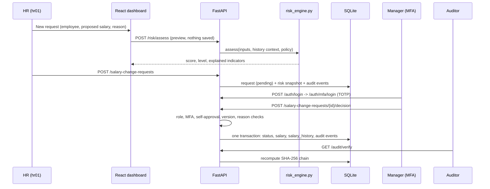
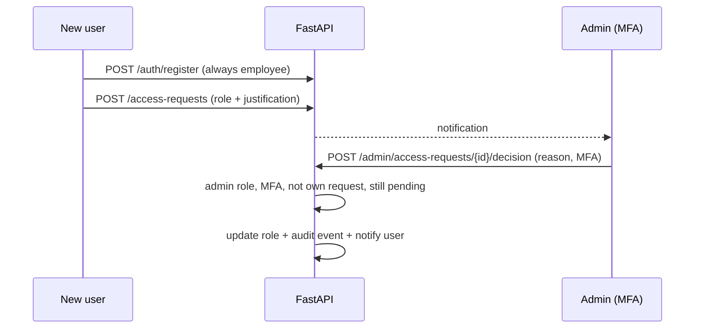

# CloudPay Shield architecture

## Request flow



## Layers

| Layer | Files | Responsibility |
|---|---|---|
| HTTP | `main.py`, `routers/*` | routing, CORS, headers, input validation (`schemas.py`) |
| Access control | `security.py`, `mfa.py` | passwords, JWT, revocation, roles, TOTP |
| Domain | `risk_engine.py` (pure functions), `services.py`, `etl.py` | scoring, context building, CSV validation |
| Persistence | `models.py`, `database.py` | SQLAlchemy 2 models; `init_db` only creates missing tables |
| Evidence | `audit.py` | append-only hash chain, verification |

`risk_engine.py` has no database or web imports, so it is unit-tested on its own (`tests/test_risk_engine.py`).

## Data model

- **Employee**: code, name, department, title, `current_salary`, `salary_version` (increments on each applied change).
- **User**: username, PBKDF2 hash, role (`employee`/`hr`/`manager`/`auditor`/`admin`), active flag, optional `employee_id`, MFA fields (encrypted secret, hashed recovery codes, last used step), lockout counters.
- **SalaryHistory**: every applied change with `source` = `approved_request` or `seed_demo`. The risk engine's history check reads this.
- **SalaryChangeRequest**: current/proposed salary, `pct_change`, `base_version`, status, risk score/level, JSON `risk_assessment` snapshot, policy version, decision details.
- **AuditEvent**: actor, role, action, target, outcome, JSON details, IP, `prev_hash`, `hash`.
- **RevokedToken**: `jti` of logged-out tokens.
- **ImportBatch**: ETL preview results; submitting turns valid rows into normal pending requests.
- **Notification**: in-app message for one user (new request to review, decision made, access request result) with an optional link to a page.
- **AccessRequest**: a user's request for a higher role (hr/manager/auditor) with justification, status and the admin's decision reason.

New tables are added with `create_all`, which only creates missing tables. It never drops or alters existing ones.

## Audit chain

```
hash_n = SHA-256( canonical_json({timestamp, actor, actor_role, action, target_type,
                                  target_id, outcome, details, prev_hash = hash_{n-1}}) )
canonical_json = sorted keys, no spaces; first event's prev_hash = "000...000" (64 zeros)
```

Writes are serialised with a lock so two events cannot share the same previous hash. `verify_chain` recomputes every link and reports the first broken event.

Limitation: the chain is in the same database. It proves that history was not edited **unless** the attacker can rewrite every later hash too. Copying the latest hash outside the system (anchoring) closes that gap.

## Decision safety

The approve path uses conditional updates inside one transaction:

```sql
UPDATE salary_change_requests SET status='approved', ... WHERE id=:id AND status='pending';
UPDATE employees SET current_salary=:new, salary_version=salary_version+1
 WHERE id=:emp AND salary_version=:base_version;
```

If either update affects 0 rows, the transaction rolls back and the API returns **409**. This prevents double approval and lost updates even with two managers clicking at once.


## Frontend structure

- **Hash router** in `App.jsx`: `#/<page>/<param>?<query>`. Public pages: landing, login, register. All other pages are protected; an unauthenticated visit stores the target in `sessionStorage` and returns there after sign-in.
- **Role-filtered sidebar** grouped into Monitor, Payroll, Investigate, Administration, Account. Hiding is cosmetic; the API repeats every check.
- **Top bar**: global request search, refresh (re-fetches the current page), notification bell (polls every 30 s), profile menu with sign-out.
- **Pages** receive `{refreshKey, onRefresh, go, param, query}` and load real data from the API, with loading, empty and error states. Nothing on the dashboard is hardcoded.
- **Drawers and dialogs**: request review and employee details open in a drawer tied to the URL (`#/requests/12`), so links from notifications and the audit log work. Approve, reject and admin actions use a confirmation dialog with a mandatory reason.

## Role assignment flow


